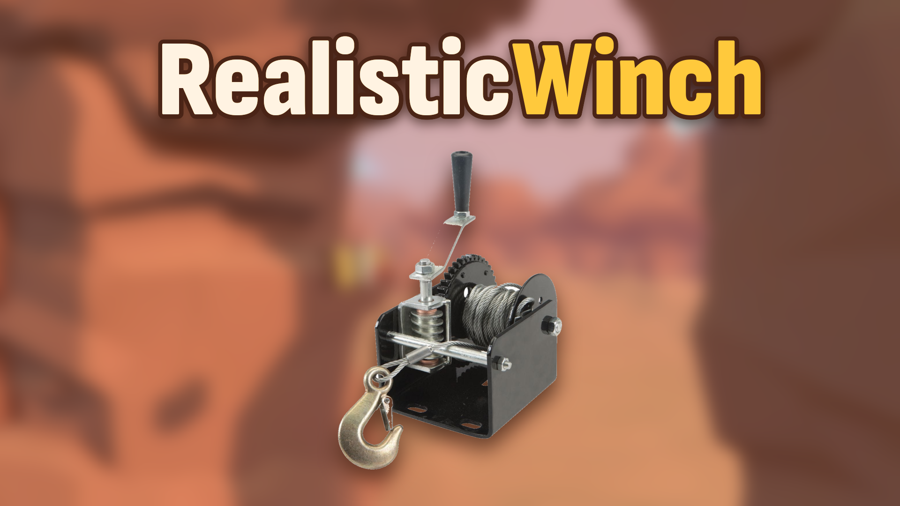

# RealisticWinch



A [MelonLoader](https://github.com/LavaGang/MelonLoader) mod for Over the Hill. The winch rope bends around rocks, trees and terrain instead of passing through them, and slack rope lies on the ground.

- While the rope is bent, it pulls along the whole path like a rope over a pulley, with friction over the bends.
- Two trucks winched together over an arch hang off each other (simul-rappel).
- The game's rope is replaced with one that follows the bends.

Works with [WinchUnlimited](https://github.com/Jeffrharr/WinchUnlimited). Use both for long rappels. Requires JoofFramework, the shared HillModding library.

## Install

1. Install MelonLoader 0.7.x into Over the Hill. Start the game once so it sets itself up, then quit.
2. Install JoofFramework into the game's `UserLibs/` folder.
3. Put `RealisticWinch.dll` into the game's `Mods/` folder.

Linux / Steam Deck (native build): MelonLoader needs the [.NET 6 runtime](https://dotnet.microsoft.com/download/dotnet/6.0), for example extracted to `~/.local/share/dotnet6`. Steam launch options:

```
LD_LIBRARY_PATH="$PWD" LD_PRELOAD="MelonLoader.Bootstrap.so" DOTNET_ROOT="$HOME/.local/share/dotnet6" %command%
```

## Settings

`UserData/MelonPreferences.cfg`, created on first launch, under `[RealisticWinch]`:

| Setting | Default | |
|---|---|---|
| `Wrap` | `true` | The rope bends around obstacles |
| `Friction` | `0.3` | Friction where the rope bends (0 = frictionless pulley) |
| `Visual` | `true` | Draw the rope following its bends and lying on the ground |

Multiplayer: the host runs the physics, so the host needs the mod. Without it, players get the normal straight rope.

## Building

The project builds against the DLLs in your game folder, so it needs:

- the .NET SDK (6.0 or newer)
- MelonLoader installed and run once, so `MelonLoader/Il2CppAssemblies/` exists
- `JoofFramework.dll` in the game's `UserLibs/`

```
dotnet build
```

`GameDir` defaults to the Steam path on Linux. Override it with `-p:GameDir="/path/to/over the hill"`. The build copies the DLL into the game's `Mods/` folder.

The rope maths in `RopeMath.cs` has no game dependencies and is unit tested:

```
dotnet test Tests
```

## License

[MIT](LICENSE). Not affiliated with Funselektor.
